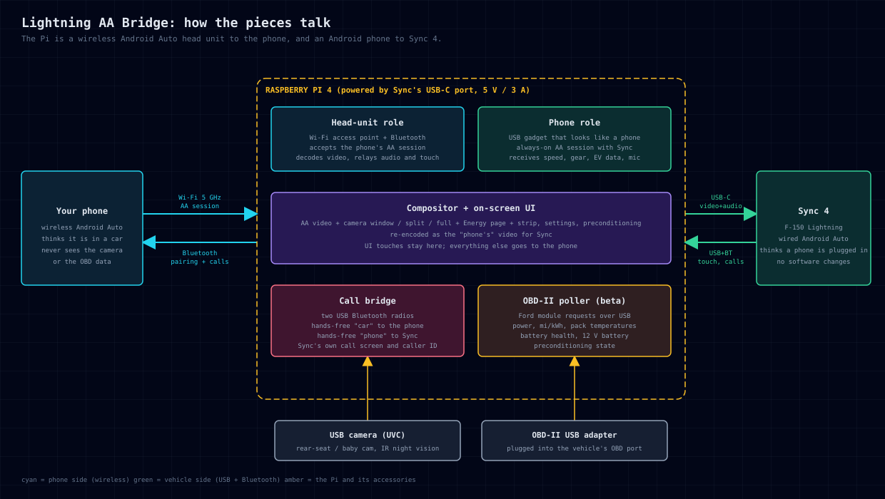

# Lightning AA Bridge

A Raspberry Pi that sits between your phone and the F-150 Lightning's Sync 4 screen. To the phone it is a wireless Android Auto head unit; to the truck it is a phone plugged into the USB port. Because it sees both sides, it can draw things on the Sync screen that neither Android Auto nor Ford offer: a camera window over AA, a live energy page from the truck's own modules, a battery-preconditioning button.

It started as a replacement for an Ottocast adapter that kept failing. It is my daily driver now.

> **Read this before cloning.** The source is here (GPL v3), but you cannot run the vehicle-facing half of it: it needs an Android Auto *device* certificate, the kind a real phone carries, which Google issues and nobody can obtain. Without it, Sync refuses the session. The code is published so it can be read, learned from, and ported, not as a kit. See [About the code](#about-the-code).

## What it does

| Feature | Status |
|---|---|
| Wireless Android Auto, nothing on the phone to install | Works daily |
| Everything AA normally gets from the truck: speed, gear, parking brake, EV battery level and range, night mode, wheel buttons, mic | Works |
| Camera window over Android Auto: drag it, pinch to resize, or go split-screen / full-screen | Works |
| Camera mirror / flip / zoom / safe-zone crop, settings persist | Works |
| Phone calls through Sync's own phone UI (caller ID on the cluster, steering-wheel answer/hang-up), phone never paired with Sync | Works; stability under long calls still being proven |
| Battery preconditioning button on the AA screen | Works |
| Energy page: live power (kW), 30-second mi/kWh, pack temperatures, battery health, 12 V battery, preconditioning state, from the truck's modules over OBD-II | **Beta** (first drives now) |
| Energy data as a resizable window next to the camera window | Planned |
| HD voice (wideband calls) | Planned, depends on hardware tests |
| Read-only root, signed updates, in-vehicle certificate refresh | Planned (needed before this is "a device you don't think about") |

The rule for everything above: **the bridge never disables or hides Android Auto.** It adds things; it does not take anything away or slow anything down noticeably (about one frame of added latency on the video path, hardware-encoded). What Android Auto itself allows while driving is unchanged: the bridge forwards the vehicle's real driving status to the phone and the release build has no way to override it.

## How it works, in one paragraph

The Pi runs two Android Auto sessions at once. On the phone side it is a head unit: it brings up a 5 GHz access point, pairs over Bluetooth, and accepts the phone's wireless AA session exactly like an aftermarket wireless adapter does. On the truck side it is a phone: it presents itself on the USB port as an Android device and keeps a wired AA session open with Sync, which gives it the screen, touch input, microphone, and the vehicle's sensor channel. In the middle, the phone's video is decoded, composited with the camera picture and the bridge's own UI, and re-encoded as the "phone's" video for Sync. Touches on the bridge's UI stay in the bridge; everything else is forwarded to the phone untouched. The phone never learns a camera exists.

Calls use the same trick with two USB Bluetooth radios: one is the "car" the phone talks hands-free to, the other is the "phone" Sync talks hands-free to, and call audio is relayed between them. Sync shows its normal call screen; the phone thinks it is in an ordinary car.

Vehicle data beyond what AA provides comes from a USB OBD-II adapter (a vLinker FS) talking to the Lightning's battery, powertrain and body modules with the same requests FORScan and the community Torque/Car Scanner PID lists use. Read-only; the bridge never writes to a module.

## Hardware

Everything is off the shelf. Rough US prices as of late 2026.

| Part | Notes | ~Cost |
|---|---|---|
| Raspberry Pi 4 (4 GB is plenty) | Pi 5 untested | $55 |
| 32 GB+ microSD, decent case with some airflow | runs warm on long drives | $15 |
| USB-C to USB-C cable, short, data-capable | one cable does both: Sync's USB-C port supplies 5 V / 3 A, which powers the Pi, and carries the Android Auto data. It has to be the USB-C port; the USB-A port can't power a Pi 4 | $8 |
| 2 × USB Bluetooth 5.x dongles | cheap ones work with some effort; see notes | $10 each |
| USB camera (UVC) with IR night vision, 90–120° lens | any webcam works; IR for the baby-cam use | $40 |
| vLinker FS (OBD-II to USB) | optional, for the Energy page | $50 |

The Pi's four USB ports are exactly full: two radios, camera, OBD adapter.

## About the code

**You cannot run the vehicle side.** To act as a phone toward Sync, the bridge presents an Android Auto device certificate, the same kind a real phone carries. Those are issued by Google. Mine is not something I can distribute, and there is no legitimate way for someone else to obtain one. Without it, Sync refuses the session. This is the single hard barrier between "my truck" and "a kit anyone can build". Questions about where to get a certificate will be closed without an answer; please don't.

**What you can do with it.** The phone-facing half (the Pi as a wireless head unit) needs no such certificate and is the same ground open-source head units cover. The compositor, the on-screen UI, the two-radio call bridge and the OBD-II poller with its Lightning request table are self-contained and readable. If you have a head unit you can legitimately present a device to, the vehicle side is there too.

**Quality.** It works daily in one truck. It is not a finished product: no read-only root yet, no signed updates, no install guide beyond `BUILDING.md`. Releases are squashed snapshots of a private working repository (`vN` tags), so the public history is release-by-release.

**Licence.** GPL v3, forced by the aasdk dependency and fine by me. Third-party components are listed in `NOTICE.md`. See `BUILDING.md` for dependencies, the build, the card install and the source layout.

## FAQ

**Does it modify the truck?** No. Nothing is flashed, no FORScan changes, no wiring beyond plugging into the USB and OBD ports. Unplug it and the truck is exactly as it was.

**Does the phone need an app?** No. It's standard wireless Android Auto from the phone's point of view.

**Lag?** Not noticeable in use. Video is hardware-decoded and re-encoded on the Pi; touch is passed straight through.

**iPhone / CarPlay?** No. The whole design is Android Auto on both sides.

**Other vehicles?** In principle anything with wired Android Auto. In practice I've only ever run it on a Lightning, and the OBD requests are Ford-specific.

**Can I buy one?** No.

## Disclaimers

- **Not affiliated with, endorsed by, or supported by Google or Ford.** Android, Android Auto and Google are trademarks of Google LLC. Ford, F-150, Lightning and SYNC are trademarks of Ford Motor Company. Names are used only to describe what the software talks to.
- **Use at your own risk.** This is a hobby project that intercepts your phone's connection to your vehicle. It can fail, freeze, or misbehave while you drive. Nothing here is a safety device. Do not interact with the bridge's screens while the vehicle is moving; set it up parked.
- **No warranty**, as the GPL says in capitals.

## Status log

- 2026-11: OBD-II Energy page in first testing. Two-USB-radio call bridge replacing the Pi's onboard Bluetooth. Concept published.
- 2026-10: Daily-driver status. Calls through Sync's UI, preconditioning button, camera window with drag/pinch.
- 2026-09/10: Dual-session architecture working end to end on the truck.
